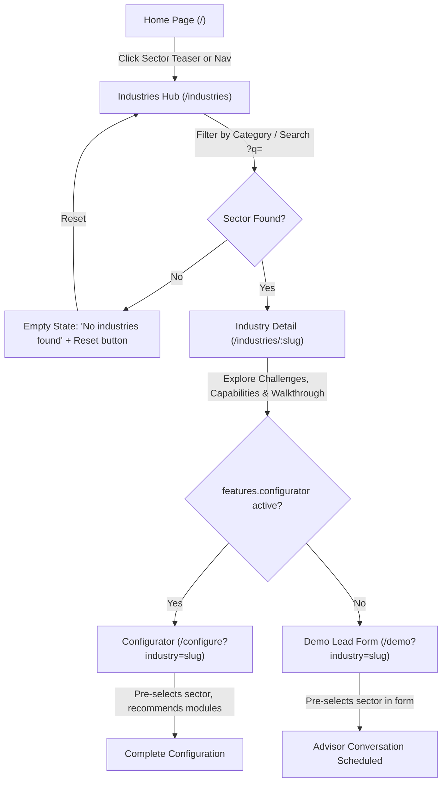
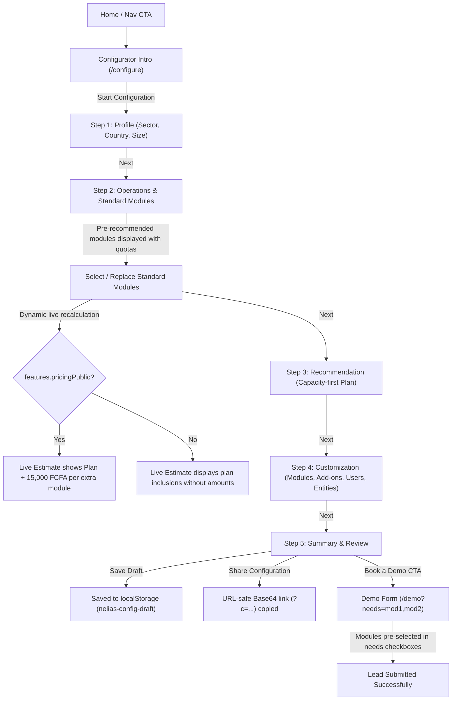
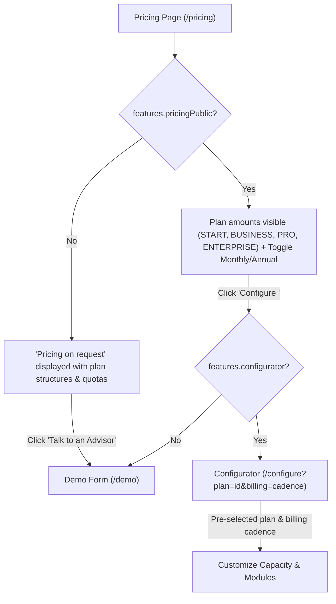
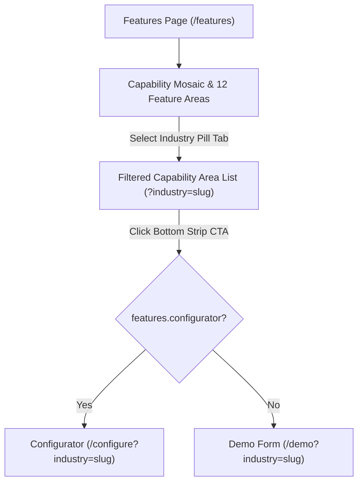
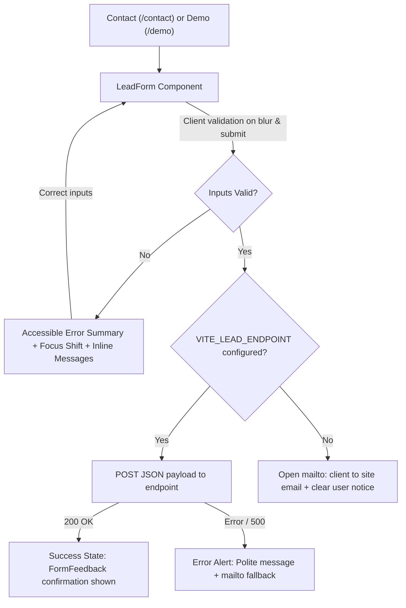

# NELIAS Marketing Portal — UI/UX Specification: User Journeys

## 1. Journey 1: Sector Discovery Journey
*From broad exploration to sector-specific operational alignment and conversion.*

---

## 2. Journey 2: Self-Service Buying & Configuration Journey
*From curiosity to precise module selection, dynamic pricing, and advisor booking.*

---

## 3. Journey 3: Pricing Evaluation to Configuration Journey
*From cost evaluation to tailored configuration.*

---

## 4. Journey 4: Capability & Features Filtering Journey
*Deep capability review leading to sector alignment.*

---

## 5. Journey 5: Lead Ingestion & Advisor Scheduling Journey
*Capturing prospects with validation, privacy, and zero fake submissions.*

---

## 6. Journey 6: Sales Presentation Journey (Five-Minute Tour)
*Field execution guide for Debass sales advisors delivering high-impact executive demonstrations.*

1. **Minute 1: The Vision & Brand Promise ([`HomePage`](file:///d:/Projects/NELIAS/nelias-marketing/src/pages/HomePage.jsx))**
   - Hero headline: *"Integrated business management. Built for your scale."*
   - Three Pillars: Unified Platform, Sector Intelligence, Pragmatic Adoption.
2. **Minute 2: Operational Proof & Scenarios ([`WhyNeliasPage`](file:///d:/Projects/NELIAS/nelias-marketing/src/pages/WhyNeliasPage.jsx))**
   - Five core African business challenges & NELIAS concrete responses.
3. **Minute 3: Sector Depth ([`IndustryDetailPage`](file:///d:/Projects/NELIAS/nelias-marketing/src/pages/IndustryDetailPage.jsx))`?slug=retail-distribution` or `pharmacies`**
   - Show pre-configured capability sets and the 5-node sector walkthrough.
4. **Minute 4: Interactive Architecture & Standard Modules ([`FeaturesPage`](file:///d:/Projects/NELIAS/nelias-marketing/src/pages/FeaturesPage.jsx))**
   - Filter capabilities by industry to demonstrate how the Sector Engine adapts standard modules.
5. **Minute 5: Commercial Clarity ([`ConfigurePage`](file:///d:/Projects/NELIAS/nelias-marketing/src/pages/ConfigurePage.jsx) or [`PricingPage`](file:///d:/Projects/NELIAS/nelias-marketing/src/pages/PricingPage.jsx))**
   - Choose a plan, demonstrate dynamic quota tracking (e.g. START 4 included + 1 extra = 64,000 FCFA/mo), and trigger the Book a Demo transition with pre-selected needs.

---

## 7. Error & Empty States Handling

1. **404 Page Not Found (`NotFoundPage`):**
   - Rendered when encountering unknown URLs (`*`) or invalid industry slugs (`/industries/invalid-slug`).
   - Clearly provides "Go to Home" primary button and "Book a Demo" / "Explore Platform" secondary button. No dead ends.
2. **Empty Search & Filters:**
   - Resources FAQ search: Displays *"No questions match your search."* with a quick "Clear search" action.
   - Industries filter: Displays *"No industries match your selection."* with an instant "Reset filters" button.
3. **Configurator Invalid Draft Link:**
   - Corrupted or invalid `?c=` strings trigger a fallback to the clean initial configurator state without crashing.
4. **Form Submission Failure:**
   - When the backend lead endpoint is unreachable or returns a 500 status, personal data is preserved in form fields, and an accessible alert provides immediate direct email and telephone contacts.
